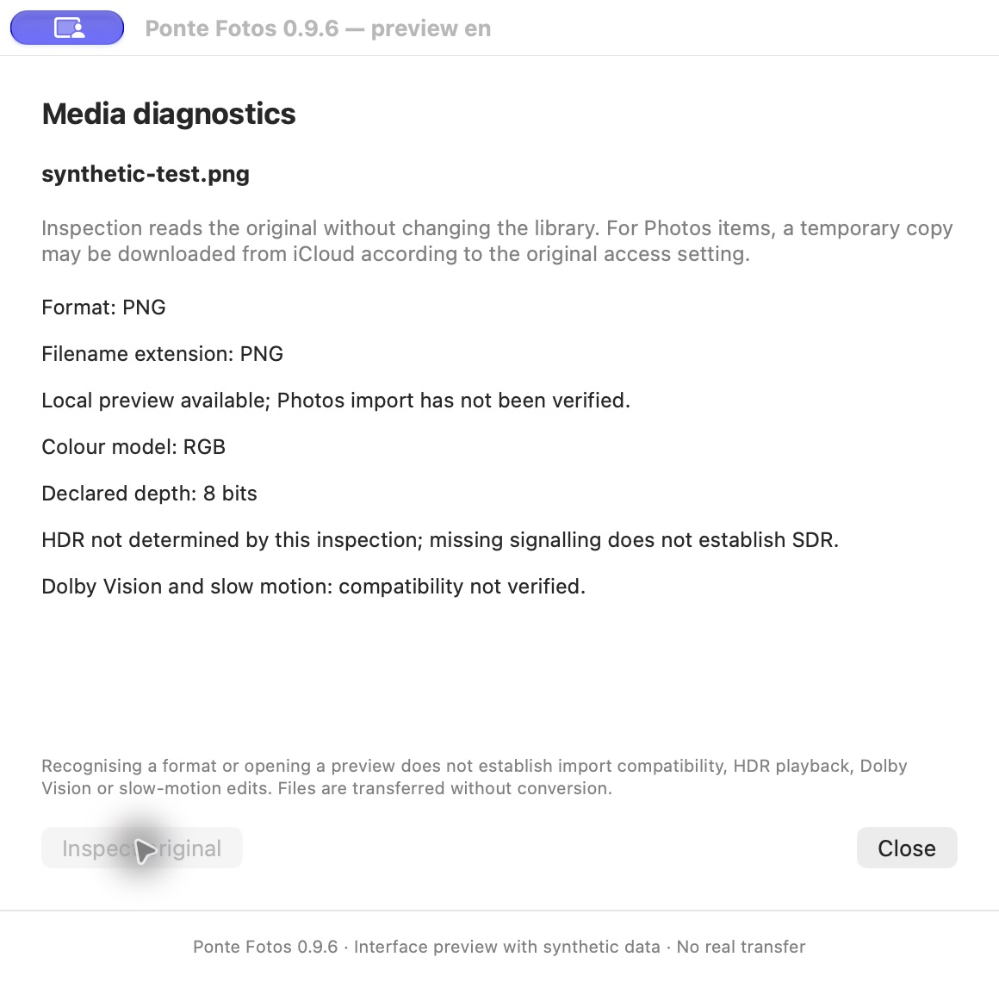
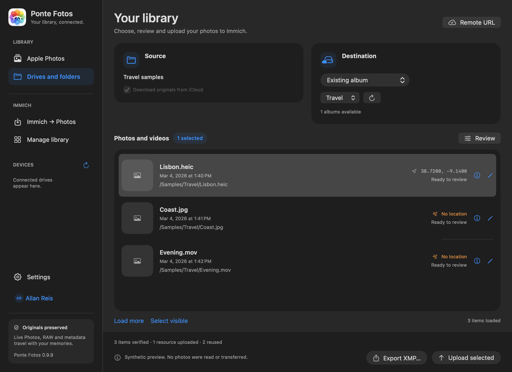
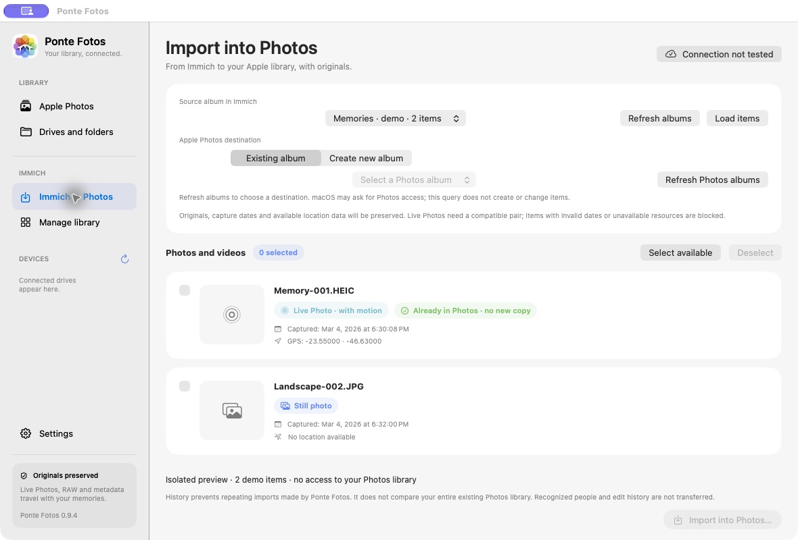

<p align="center"></p>

**English** · [Português (Brasil)](README.pt-BR.md)

# Ponte Fotos

[](https://github.com/allanpreis/ponte-fotos/releases/latest)
[](https://github.com/allanpreis/ponte-fotos/actions/workflows/ci.yml)
[](#requirements)
[](LICENSE)

**[Download](https://github.com/allanpreis/ponte-fotos/releases/latest) · [Installation](#-install-a-release) · [Contribute](CONTRIBUTING.md) · [Report a bug](https://github.com/allanpreis/ponte-fotos/issues/new/choose)**

A native macOS app that connects Apple Photos and Immich in both directions. Upload originals from Photos or folders to Immich, import Immich albums into Photos, and review dates and locations. It also provides tools to organize your server library.

**Version: 0.9.9 · macOS 14 or later · Apple Silicon · Immich 3.x**

**Languages:** the app supports English and Brazilian Portuguese. It follows your macOS language by default, with English as the fallback for other languages. Choose **Settings → Appearance → App language** to use **System**, **English**, or **Português (Brasil)**. On first launch, **System** is selected. Changes apply immediately and are saved for future launches. This README, its screenshots, and presentation video use English; the [Portuguese README](README.pt-BR.md) keeps the Portuguese media.

The app is written in Swift and SwiftUI, uses macOS frameworks, and requires no project-operated cloud services, Node.js, Docker, or external Swift packages. An Immich server is required for connection, uploads, imports, and library management; local export and file review work without one.

Version 0.9.7 adds transfer account selection and connection by URL availability. It retains the media diagnostics and post-import verification introduced in 0.9.6, including an explicit recheck action for pending results. The app reports format and preview availability, image color properties and video PQ/HLG signaling without treating them as proof of complete HDR compatibility. [Release notes](https://github.com/allanpreis/ponte-fotos/releases/tag/v0.9.9).

## Large transfers — bounded concurrency

Version 0.9.8 prepares small windows of up to eight complete media items with a 128 MiB soft target. A final whole item can exceed that target. Existing standalone images can be checked by SHA-1 in batches and reused only after current identity, ownership, checksum, availability and non-Live status are revalidated. Videos and Live Photos retain the ordinary upload path; the paired video remains before its image. The same hash is reused for upload, and multipart disk work runs on a utility task. Known free disk space is checked before copying/building temporary bodies, with a reserve; unknown PhotoKit resource sizes and changing capacity can still cause write failures.

Counters distinguish verified items, newly uploaded resources and reused resources. Per-phase local measurements support further optimization; they are not bandwidth telemetry. Network changes and failures pause between complete items without replaying the batch automatically. The header now says only **Local URL** or **Remote URL**, keeping the diagnostic in settings.

Version 0.9.9 processes at most two complete media items at a time. Items sharing a resource hash run separately; units above 16 MiB of prepared multipart payload run alone. A pause waits for active items, including every Live Photo resource, before stopping. Progress counts completed units, independent of completion order. Duplicate source rows are scheduled once by identity. These bounds are deliberate; they are not a promise of real-server speedup. Whole-Photos-batch size prediction and large real-server throughput/memory validation remain limited. [Validation and limits](https://github.com/allanpreis/ponte-fotos/releases/tag/v0.9.9).

## Transfer accounts and connection availability

The account menu below Settings in the sidebar lets you select an account for uploads and imports without replacing the main connection. It shows the account name and a circular profile image when available, with initials or a person icon as a fallback. Profile images are optional and cached only in memory; missing image permission or a failed download does not block transfers. IDs and API keys are never used as menu labels. The selected account, server address and album are shown before confirmation; identity and required API permissions are revalidated before operations. Transfer histories remain isolated by profile and account.

**Automatic** tries the configured local URL first, then the remote URL only when the local service is unavailable. **Local** and **Remote** use only their respective URL. The app validates the Immich API and expected account rather than accepting a ping or any successful HTTP response, and explains the chosen address. Wi-Fi names and the Location permission used to read them are no longer required; Photos GPS handling remains available. Existing URLs, profile identifiers, accounts and histories are retained; a legacy SSID field may remain stored but is ignored.

A transfer freezes its connection for the batch. A network change pauses after the current media item, including all Live Photo resources, and requires revalidation before continuing. This is an item-level restart, without partial-byte resume.

Account selection uses the same row sizing as sidebar navigation. Transfer buttons use the native macOS bordered style, matching the other toolbar actions in both appearances. Existing presentation video illustrates earlier versions; the updated screenshots below show 0.9.9.

Validation for 0.9.7 includes synthetic routing/account/history tests and real JPEG/Live Photo uploads through a dedicated test account. Repeating the upload and rechecking the previously imported Photos items created no new copies; independent downloads matched the server and approved samples. Fresh Photos original creation and physical Remote/VPN access were not exercised in this round. [Validation details and limits](https://github.com/allanpreis/ponte-fotos/releases/tag/v0.9.7).

## 📥 Immich → Apple Photos

Open **Immich → Photos** in the sidebar. Test the connection, choose the source account from the sidebar account menu, refresh the albums, load an album, and select items. Check capture dates, GPS, and the Live Photo indicator; choose **Existing album** or **Create new album** as the destination, then confirm the import.

The app downloads originals, verifies their checksums, and uses PhotoKit to create items in Photos on this Mac. iCloud follows your Photos settings. Immich originals remain untouched. Items without a valid date and explicit time zone, with invalid locations, or with unavailable resources are blocked. Live Photos require a compatible image and video. Recognized people and editing history are not transferred.

**Refresh Photos albums** lists only editable destinations without creating or changing items. Albums with identical names are distinguished in the list and selected by identifier. A new album is created only after confirmation and becomes the destination for subsequent batches.

Photos previously imported by the app can be selected and added to another album without downloading them again, creating more copies, or removing them from earlier albums. A local history for each profile/account prevents repeating imports made by Ponte Fotos; it does not compare your entire preexisting library. Results without final confirmation remain blocked to prevent automatic retries.

## Media diagnostics and import verification

Use the info button beside a source item to inspect its original locally. Inspection reports the format, local preview availability, available colour properties and PQ/HLG video signalling. JXL files are included in folder scans, but recognition or a working preview does not establish Photos import support. Inspecting Photos resources may download temporary originals from iCloud according to the access setting. Temporary copies are removed afterwards. HDR image gain maps, Dolby Vision and slow-motion editing behaviour are not validated.

After a new Immich → Photos import, the app checks that the created item is visible and that its capture date, available location and Live Photo subtype match the source. A mismatch or inconclusive result keeps the history pending and blocks repeat imports until the library is checked. Previously imported items are checked before being added to another album. These checks do not re-export or compare the original stored in Photos, and do not validate HDR playback.



Interface preview with synthetic data; no real transfer is shown.

## Presentation

https://github.com/user-attachments/assets/937288e1-6684-49f7-9696-dfd71f2f05e8

[Watch or download the video](Assets/ponte-fotos-promo-en.mp4) · [Poster](Assets/ponte-fotos-poster-en.png) · 66 seconds · no audio · 1080p · English text.

This illustrative video predates 0.9.7 and does not show the current sidebar account menu or availability-based routing. It illustrates transfers in both directions, metadata review, importing into existing or new Photos albums, adding previously imported items to albums without more copies, Live Photo protection, organization, and automatic connection selection. The diagrams use synthetic data and are not recordings of the interface.

## Interface





The library screenshot shows the 0.9.9 sidebar account menu and primary transfer button with synthetic data. The import screenshot illustrates the earlier 0.9.4 interface. Neither screenshot shows a real transfer or accesses a personal library.

## 📦 Install a release

Download [Ponte Fotos 0.9.9 for Apple Silicon](https://github.com/allanpreis/ponte-fotos/releases/download/v0.9.9/Ponte-Fotos-0.9.9-arm64.zip), extract it, and move **Ponte Fotos.app** to your user's Applications folder. Quit the previous version before replacing it. The package has a local ad hoc signature; it does not yet have a Developer ID signature or notarization. You do not need to disable macOS protections.

[🚀 Release and downloads](https://github.com/allanpreis/ponte-fotos/releases/tag/v0.9.9) · [📝 Release history](https://github.com/allanpreis/ponte-fotos/releases)

## Appearance and settings

Open **Settings** in the sidebar or press **⌘,**:

- **Connection**: local/remote addresses, **Automatic/Local/Remote** mode, and the main API key. No Wi-Fi name or Location permission is needed in the current app.
- **Accounts & API**: register additional accounts in macOS Keychain after validating the main connection. Choose a registered account from the menu below **Settings** in the sidebar; this does not replace the main key or automatically choose a transfer account when registering it.
- **Appearance**: **Light**, **Dark**, or **System** theme, glass effects, and **App language**. Theme choices apply to review and management windows. Language changes apply immediately, without restarting the app.

The main screen keeps the source, destination, media list, and actions visible without a scrolling connection panel. In smaller windows, the list keeps its own scroll area; longer forms scroll only within Settings.

**Use transparency and glass** controls the navigation's appearance. Native Liquid Glass is used on macOS 26 or later; macOS 14/15 use compatible translucent materials. Turning this option off or enabling **Reduce transparency** in macOS uses opaque surfaces. Photos and forms remain solid for readability. Language, theme, and glass preferences are nonsensitive UserDefaults values; they are not stored with API keys.

## Features

| Area | What it does |
| --- | --- |
| Apple library | Lists photos in pages of 100 items, supports selection, and can download iCloud originals with permission. |
| Folders and drives | Recursively reads the selected folder, including subfolders, and identifies image, video, and XMP metadata. |
| Review | Lets you complete or correct dates and GPS before preparing files for upload. |
| Export | Exports originals with XMP sidecars without modifying the Apple library or source files. |
| Upload | Uploads to the timeline, an existing album, or a new album; checks checksums, dates, available GPS, and Live Photo associations. |
| Network connection | Tries the local URL before the remote URL by availability in Automatic mode; Local and Remote remain exclusive. |
| Duplicates | Finds files with identical checksums across selected accounts and albums, identifies Live Photos, and lets you review extra still copies. |
| Comparison | Compares the contents of two albums and organizes album membership without deleting library files. |
| Person and age | Selects images by person, birth date recorded in Immich, and an inclusive age range. |
| Accounts and history | Uses account-specific keys and records the last 20 management operations, including uncertain results. The app also allows selecting a registered account for transfers, with separate profile/account histories. |

## Requirements

- An Apple Silicon Mac running macOS 14 or later. The current script builds an `arm64` executable; Intel has not been validated.
- Xcode 26 or later with the macOS 26 SDK, selected as the active developer toolchain. The app deployment target remains macOS 14; older SDKs cannot compile the Liquid Glass APIs.
- An accessible Immich 3.x server and an API key for the relevant account. The integration was developed with Immich 3.3.5; future API changes may require updates.
- Free disk space to prepare temporary copies and, when requested, download iCloud originals.

## Build and install from source

```sh
xcode-select --install
```

If the tools are already installed, continue:

```sh
git clone https://github.com/allanpreis/ponte-fotos.git
cd ponte-fotos
zsh build.sh
mkdir -p "$HOME/Applications"
ditto "build/Ponte Fotos.app" "$HOME/Applications/Ponte Fotos.app"
open "$HOME/Applications/Ponte Fotos.app"
```

Quit any previous version of the app before replacing it. The build produces `build/Ponte Fotos.app` with a local ad hoc signature. The project does not yet have a Developer ID signature, notarization, or an official installer; macOS may require approval to open the app and may request permissions again after a rebuild. You do not need to disable Gatekeeper or other system protections.

Do not run the bundle directly from a synced folder that changes its extended attributes: this can invalidate the signature. Use a local applications folder.

## First connection

1. Open **Settings → Connection** in the app (or press **⌘,**).
2. Enter your Immich URL and the destination account's API key. Use the base URL without embedded credentials or query parameters.
3. Choose **Automatic**, **Local**, or **Remote**, enter the URLs for that mode, and click **Test connection**.
4. To save the details, click **Save settings**. They are stored in macOS Keychain.

The published code starts with an empty configuration. Example values: local URL `http://immich.local:2283`, remote URL `https://photos.example.com`. These are fictional examples; replace them with your own details in the interface.

The app does not read `.env` files. You do not need to create one to build or use the project. Never put API keys or private URLs in the source code or upload them to GitHub.

### API permissions

Grant only the permissions required for your intended workflow. An API key does not extend the account's access to other people's albums.

| Operation | Relevant permissions |
| --- | --- |
| Connection and upload | `server.version`, `user.read`, `asset.upload`, `asset.read` |
| Import from Immich to Photos | `user.read`, `asset.read`, `asset.download`, `album.read`; previews also require the relevant thumbnail permission |
| Queries and thumbnails in library management | `user.read`, `album.read`, `asset.read`, `asset.view` |
| Optional account profile image | `userProfileImage.read`; not required for uploads or imports, which continue with initials or an icon |
| People | `person.read`, in addition to query permissions |
| Creating an album during upload | `album.create` and the relevant query/organization permissions |
| Adding/removing album membership | `albumAsset.create`, `albumAsset.delete`, depending on the operation |
| Moving duplicates to the trash | `asset.delete`, plus permissions to read and preserve album membership |
| Applying reviewed metadata to an uploaded asset | `asset.update`, when required by the workflow |

The server may require additional scopes depending on its version and the endpoint. Missing permissions or lack of access to an asset will block the operation; check the app's message. Avoid granting `all` if you do not need every feature.

### Automatic address selection

In the current app, enter the local and/or remote URL and choose the connection mode. No SSID or Location prompt is used for routing.

- **Automatic** tries the local URL first, regardless of Wi-Fi, Ethernet or VPN, then the remote URL on an eligible connectivity/service-unavailability failure. One configured URL is sufficient in this mode.
- **Local** uses only the local URL; **Remote** uses only the remote URL. A missing URL for an exclusive mode is a configuration error.
- Each candidate must respond as Immich with the expected account. Authentication errors, an invalid server or a mismatched account block the operation without trying another destination.
- The chosen address and reason are displayed. Connections are revalidated before transfers and after relevant network changes or failures.
- The transfer keeps its frozen client for the batch. A route change finishes the current media resource set, pauses before the next item and requires revalidation. Import previews must be refreshed if their source address/account changes.
- Existing profile identifiers, accounts, URLs and histories are preserved. History remains scoped to the logical profile and account across both addresses.

Validation pins the account UUID, not a cryptographic server identity. Configure only addresses belonging to the same trusted server. HTTP is accepted but sends the key and media without transport encryption; prefer HTTPS, especially outside your local network.

## Upload photos and videos

1. Select **Apple Photos** in the sidebar and grant access to Photos. Or select **Drives and folders** to choose a source folder or drive.
2. Select items and check the date/GPS indicators. Downloading iCloud originals depends on access to the account/library in macOS itself.
3. Use **Review** to complete missing dates or locations. Uploading without a reliable date requires review; the app does not automatically use file creation time as the capture date.
4. Choose the transfer account from the sidebar menu, then the destination: no album, an existing album, or a new album. Check the displayed account and server before confirming.
5. Upload a small sample and check the result in Immich before sending a large batch.

Originals retain their bytes; an XMP sidecar carries dates and locations from the library/review. Preparation does not modify the source file. An existing XMP sidecar from a folder is merged while preserving additional fields.

For Live Photos from Apple Photos, the motion video is uploaded first and associated with the main image. HEIC and MOV files from external folders are independent items: the app does not assume they are a pair based only on their names. Associated RAW and JPEG files are preserved as distinct resources without automatic stacking.

**Pause after this item** finishes the current resource set. History and checksums help reuse previously uploaded resources that are still valid. Interruptions can leave pending or uncertain results: check the server before retrying.

### Metadata verification

The workflow compares checksums, capture instants (tolerance under one second), available GPS (tolerance of 0.00001 degrees), and Live Photo video associations. A late or mismatched response remains pending/mismatched instead of being incorrectly marked successful.

PhotoKit supplies an absolute instant; previews use the Mac's time zone, and XMP sidecars use UTC. Check travel photos and manual corrections in the timeline. The app exports originals without promising to reproduce edits, Apple albums, captions, keywords, faces, or all proprietary Apple metadata. Favorite status is sent but is not part of this verification.

## Manage Immich

With a validated connection, open **Manage library** in the sidebar. In **Accounts & API**, click **Use current connection account** or add an account with its own key. Additional accounts are saved separately in Keychain; the current account can be used only in memory for that session.

### Albums and duplicates

Select albums and run the query. Comparison uses exact checksums and media types, including the main image of Live Photos. Matching names or similar appearance alone do not establish duplication. Recompressed, edited, or otherwise byte-different files may be absent from the results.

Each copy shows its account, name, format, metadata, and accessible albums. **Live Photo · with motion** and **Still photo** appear in separate groups. A Live Photo is suggested for retention; moving any Live Photo to the trash is blocked. Groups without a connected owner account may also be blocked.

Before moving items to the trash, the app revalidates content, ownership, motion, access, and album membership; it adds and confirms membership in accessible albums on the retained copy before the first deletion. Deletion is recoverable in Immich (`force: false`); the app does not empty the trash. It cannot preserve album membership invisible to the connected accounts.

### Compare albums

Compares two albums. By default, it shows content found in both; you can also include items exclusive to either album. For each group, choose to leave it unchanged, keep it in both albums, or gather it in one album. Additions are confirmed before source album membership is removed. Files remain in the server library.

### Person and age

Select an account, person, source, destination, and age range. The person must have a birth date recorded in Immich. Selection uses the local capture date and inclusive boundaries; a February 29 birthday is treated as March 1 in a non-leap year. The source can be one album or all albums accessible to the account, excluding the destination.

Review the results before organizing. The workflow revalidates the birth date, association with the person, capture date, and content; it retains membership in other albums outside the selected source.

### Review and history

Every management change goes through a review screen and explicit confirmation. History records up to 20 runs and each action before/after its request. A failure or interruption can leave some changes confirmed and others uncertain: there is no overall rollback or automatic retry. Check history and Immich before acting again.

### Management limits in this version

- Up to 100 albums and 30,000 unique items per analysis.
- Comparison and person/age workflows exclude Live Photos, stacks, offline files, and edited files; duplicate queries include Live Photo images with protection against discarding them.
- The owner account may be required even for organization operations, as a conservative safeguard.
- Queries can be canceled; changes cannot be canceled in the middle of a network call.
- Completed analyses are not restored after closing the management window.
- Creating albums or selecting additional destination albums in the duplicates workflow, and bulk decisions in comparison, are not yet available.
- Large operations can be slow because of safety revalidation.

## Privacy and local storage

| Location | Contents |
| --- | --- |
| macOS Keychain | Connection profile, URLs and main key; additional account keys use a separate service. A legacy SSID may remain stored for migration but is ignored by the current app. |
| `~/Library/Application Support/PonteFotos/reviews.json` | Metadata reviews. |
| `~/Library/Application Support/PonteFotos/history/` | Upload history, IDs, and checksums. |
| `~/Library/Application Support/PonteFotos/management/` | Management history by profile, saved with file mode `0600`. |
| `~/Library/Application Support/PonteFotos/staging/` | Temporary copies; abrupt interruption can leave files behind. |
| Selected export folder | Originals and XMP sidecars exported by the user. |

Account profile images are fetched from the selected validated Immich connection and cached only in process memory; they are not saved alongside keys or histories. Histories, reviews, and exports may contain personal names, IDs, dates, and GPS. Do not publish them in issues, logs, or repositories. **Forget connection** removes the main connection from Keychain; current fields remain in memory until you close the app. This does not automatically remove additional accounts or local histories.

The `.gitignore` excludes `.env`, common credentials, builds, bundles, archives, and local state. It does not remove secrets already tracked by Git or replace review before each commit. The repository contains application source code, app assets, and README documentation and media.

Reverse import history is stored in `~/Library/Application Support/PonteFotos/reverse-import/`, with restricted access and no API keys.

## Repository structure

```text
Sources/          Swift application source code
Assets/           Logo, icons, localized strings, screenshots, presentation videos and posters
Info.plist        Version, identifier, and macOS permissions
build.sh          Build and local signing
README.md         English installation, features, usage, and limitations
README.pt-BR.md   Brazilian Portuguese documentation
.gitignore        Excludes builds, credentials, and local data
```

The public repository contains the files needed to build the app and display this presentation. Releases provide downloads and the change history.

## Troubleshooting

| Symptom | What to check |
| --- | --- |
| Server does not respond | Immich is running; URL/port, route, DNS, and firewall. You do not need to edit source code to configure the address. |
| Wrong address or account | Check Automatic/Local/Remote, configured URLs and the selected transfer account. Routing does not require a Wi-Fi name or Location permission. Refresh the source albums after a source change. |
| Empty library or access denied | System Settings → Privacy & Security → Photos; confirm access and the library selected in Photos. |
| iCloud original unavailable | iCloud access, internet, free space, and the option to download originals. |
| Management action blocked | Owner account's key, API permissions, album access, and the workflow's media exclusions. |
| Visually similar duplicates missing | The method requires exact checksums; it does not use perceptual recognition of similar images. |
| Invalid signature | Rebuild in a local folder, check `codesign`, and install the bundle outside synced folders. |
| Uncertain result | Check history and the server; do not blindly repeat the operation. |

## Project status

The app is under active development, with local signing and automated tests. Back up your library and server, and start with small batches before using tools that change album membership or move copies to the trash.

This is an independent project with no official affiliation with Apple or Immich. Licensed under the [MIT License](LICENSE).

## Community and credits

Created and maintained by [Allan Reis](https://github.com/allanpreis). See the [contributors](https://github.com/allanpreis/ponte-fotos/graphs/contributors). Code, documentation, translation, accessibility and testing contributions are welcome.

[Contributing](CONTRIBUTING.md) · [Code of conduct](CODE_OF_CONDUCT.md) · [Security policy](SECURITY.md) · [Release history](https://github.com/allanpreis/ponte-fotos/releases)
