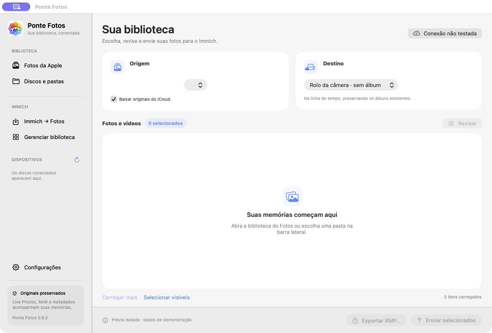
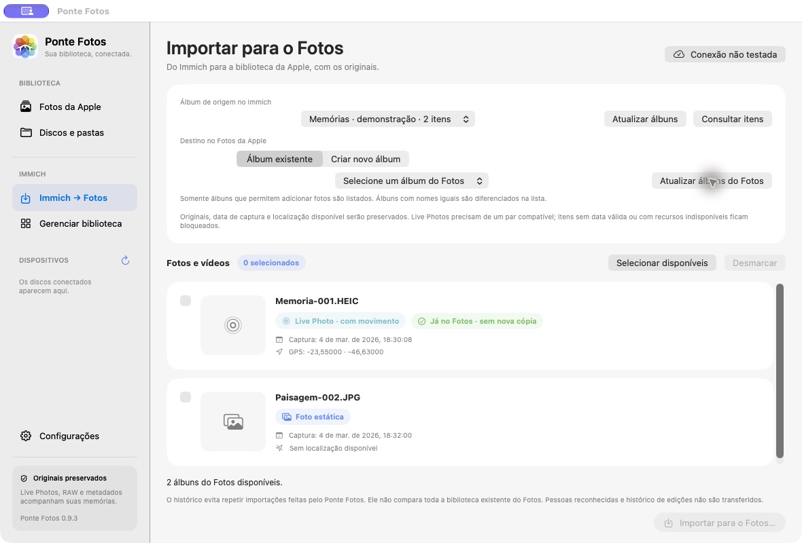

<p align="center"></p>

[English](README.md) · **Português (Brasil)**

# Ponte Fotos

Aplicativo nativo para macOS que conecta o Fotos da Apple e o Immich nos dois sentidos. Envie originais do Fotos ou de pastas para o Immich, importe álbuns do Immich para o Fotos e revise data e localização. Também oferece ferramentas para organizar a biblioteca do servidor.

**Versão: 0.9.6 · macOS 14 ou superior · Apple Silicon · Immich 3.x**

**Idiomas:** o aplicativo oferece português (Brasil) e inglês. Por padrão, acompanha o idioma do macOS e usa inglês para outros idiomas. Em **Configurações → Aparência → Idioma do aplicativo**, escolha **Sistema**, **English** ou **Português (Brasil)**. Na primeira abertura, **Sistema** vem selecionado. A mudança é imediata e a preferência fica salva. Este README mantém os prints e o vídeo em português; o [README em inglês](README.md) usa mídia em inglês.

O aplicativo é escrito em Swift e SwiftUI, usa os frameworks do macOS e não depende de serviços de nuvem próprios, Node.js, Docker ou pacotes Swift externos. Um servidor Immich é necessário para conexão, envio, importação e gestão; exportação local e revisão de arquivos podem ser usadas sem ele.

A versão 0.9.6 adiciona diagnóstico de mídia e conferência após importar no Fotos da Apple, com reconferência explícita de resultados pendentes. O app informa formato e disponibilidade de prévia, propriedades de cor das imagens e sinalização PQ/HLG dos vídeos, sem tratar esses dados como comprovação de compatibilidade HDR completa. [Notas da versão](https://github.com/allanpreis/ponte-fotos/releases/tag/v0.9.6).

## 📥 Immich → Fotos da Apple

Na barra lateral, abra **Immich → Fotos**. Teste a conexão, atualize os álbuns, consulte um álbum e selecione os itens. Confira a data de captura, GPS e o indicador de Live Photo; escolha **Álbum existente** ou **Criar novo álbum** no destino e confirme a importação.

O app baixa os originais, verifica o checksum e usa o PhotoKit para criar os itens no Fotos deste Mac. O iCloud segue os ajustes do Fotos. Os originais do Immich permanecem intactos. Itens sem data válida/fuso explícito, localização inválida ou recursos indisponíveis ficam bloqueados. Live Photos exigem imagem e vídeo compatíveis. Pessoas reconhecidas e histórico de edições não são transferidos.

A opção **Atualizar álbuns do Fotos** lista somente destinos editáveis, sem criar ou alterar itens. Álbuns com nomes iguais são diferenciados na lista e selecionados pelo identificador. Um novo álbum é criado somente após confirmação e passa a ser o destino dos próximos lotes.

Fotos já importadas pelo app podem ser selecionadas e adicionadas a outro álbum sem baixar novamente, criar novas cópias ou removê-las dos álbuns anteriores. Um histórico local por perfil/conta evita repetir importações feitas pelo Ponte Fotos; ele não compara toda a biblioteca preexistente. Resultados sem confirmação final ficam bloqueados para evitar repetição automática.


## Diagnóstico de mídia e conferência de importação

Use o botão de informação ao lado de um item de origem para inspecionar o original localmente. O diagnóstico informa formato, disponibilidade de prévia local, propriedades de cor disponíveis e sinalização PQ/HLG de vídeos. Arquivos JXL entram na busca em pastas, mas reconhecimento ou prévia funcional não comprovam suporte à importação no Fotos. Inspecionar recursos do Fotos pode baixar originais temporários do iCloud conforme a opção de acesso; as cópias temporárias são removidas ao terminar. Gain maps de imagens HDR, Dolby Vision e comportamento das edições de câmera lenta não são validados.

Depois de uma nova importação Immich → Fotos, o app confere presença do item criado, data de captura, localização disponível e subtipo Live Photo. Divergências ou resultados inconclusivos mantêm o histórico pendente e bloqueiam novas tentativas até conferir a biblioteca. Itens previamente importados são conferidos antes de adicioná-los a outro álbum. Essa conferência não reexporta nem compara o original armazenado no Fotos e não valida reprodução HDR.


Prévia da interface em inglês com dados sintéticos; não mostra uma transferência real.

## Apresentação

https://github.com/user-attachments/assets/256027d1-94bc-454b-8237-e7e4977729b8

[Assistir ou baixar o vídeo](Assets/ponte-fotos-promo.mp4) · [Pôster](Assets/ponte-fotos-poster.png) · 66 segundos · sem áudio · 1080p.

A apresentação ilustra os dois sentidos da transferência, revisão de metadados, importação para álbuns existentes ou novos no Fotos, vínculos sem novas cópias para itens já importados, proteção de Live Photos, organização e conexão automática. Os diagramas usam dados sintéticos e não são gravações da interface.

## Interface





As imagens usam dados de demonstração, sem acesso a bibliotecas pessoais.

## 📦 Instalar pela release

Baixe o [Ponte Fotos 0.9.6 para Apple Silicon](https://github.com/allanpreis/ponte-fotos/releases/download/v0.9.6/Ponte-Fotos-0.9.6-arm64.zip), extraia e mova **Ponte Fotos.app** para a pasta Aplicativos do seu usuário. Encerre a versão anterior antes de substituir. O pacote tem assinatura local ad hoc; ainda não possui Developer ID nem notarização. Não é necessário desativar proteções do macOS.

[🚀 Release e arquivos](https://github.com/allanpreis/ponte-fotos/releases/tag/v0.9.6) · [📝 Histórico de versões](https://github.com/allanpreis/ponte-fotos/releases)

## Visual e configurações

Abra **Configurações** na barra lateral ou use **⌘,**:

- **Conexão**: endereços local/remoto, modo Automático/Local/Remoto, Wi-Fi doméstico e chave principal.
- **Contas e API**: contas adicionais usadas pela gestão; exige conexão validada e mantém chaves no Chaves do macOS.
- **Aparência**: tema Claro, Escuro ou Sistema, efeitos de vidro e **Idioma do aplicativo**. O tema também vale para revisão e gestão. O idioma muda imediatamente, sem reiniciar o app.

A tela principal mantém origem, destino, lista de mídia e ações sem um painel rolável de conexão. Em janelas menores, a lista conserva sua própria rolagem; formulários extensos rolam somente dentro de Configurações.

A opção **Usar transparência e vidro** controla o acabamento da navegação. O Liquid Glass nativo é usado no macOS 26 ou superior; no macOS 14/15 são usados materiais translúcidos compatíveis. Desativar a opção ou ativar **Reduzir transparência** no macOS usa superfícies opacas. Fotos e formulários permanecem sólidos para manter a leitura. Idioma, tema e preferência de vidro são dados não sensíveis no UserDefaults; não são gravados junto de chaves de API.

## Recursos

| Área | O que faz |
| --- | --- |
| Biblioteca Apple | Lista fotos em páginas de 100 itens, permite seleção e pode baixar originais do iCloud mediante autorização. |
| Pastas e discos | Lê recursivamente a pasta escolhida, incluindo subpastas, e identifica metadados de imagem, vídeo e XMP. |
| Revisão | Permite completar ou corrigir data e GPS antes de preparar os arquivos para envio. |
| Exportação | Exporta originais com XMP complementar, sem modificar a biblioteca Apple ou arquivos de origem. |
| Upload | Envia para a linha do tempo, um álbum existente ou um novo álbum; confere checksum, data, GPS disponível e associação Live Photo. |
| Conexão por rede | Alterna entre endereço local e remoto conforme o Wi-Fi configurado, com modos manuais disponíveis. |
| Duplicatas | Encontra arquivos com checksum idêntico entre contas e álbuns selecionados, identifica Live Photos e permite revisar cópias estáticas excedentes. |
| Comparação | Compara conteúdos de dois álbuns e organiza seus vínculos sem apagar os arquivos da biblioteca. |
| Pessoa e idade | Seleciona imagens por pessoa, aniversário registrado no Immich e intervalo inclusivo de idade. |
| Contas e histórico | Usa chaves por conta e registra as últimas 20 operações de gestão, incluindo resultados incertos. |

## Requisitos

- Mac com Apple Silicon e macOS 14 ou superior. O script atual gera um executável `arm64`; Intel ainda não foi validado.
- Xcode Command Line Tools com o compilador Swift e SDK do macOS. Xcode completo também pode fornecer essas ferramentas.
- Servidor Immich 3.x acessível e chave de API da conta correspondente. A integração foi desenvolvida com Immich 3.3.5; mudanças futuras na API podem exigir ajustes.
- Espaço livre para preparar cópias temporárias e, quando solicitado, baixar originais do iCloud.

## Instalar a partir do código

```sh
xcode-select --install
```

Se as ferramentas já estiverem instaladas, prossiga:

```sh
git clone https://github.com/allanpreis/ponte-fotos.git
cd ponte-fotos
zsh build.sh
mkdir -p "$HOME/Applications"
ditto "build/Ponte Fotos.app" "$HOME/Applications/Ponte Fotos.app"
open "$HOME/Applications/Ponte Fotos.app"
```

Encerre uma versão anterior do aplicativo antes de substituí-la. O build produz `build/Ponte Fotos.app` com assinatura local ad hoc. O projeto ainda não possui assinatura Developer ID, notarização ou instalador oficial; o macOS pode exigir autorização para abrir o aplicativo e voltar a pedir permissões após uma recompilação. Não há necessidade de desativar o Gatekeeper ou outras proteções do sistema.

Não execute o bundle diretamente de uma pasta sincronizada que modifique seus atributos estendidos: isso pode invalidar a assinatura. Prefira uma pasta local de aplicativos.

## Primeira conexão

1. Abra **Configurações → Conexão** no app (ou **⌘,**).
2. Informe a URL do seu Immich e a chave de API da conta de destino. Use a URL base, sem credenciais ou parâmetros embutidos.
3. Escolha o modo **Local** ou **Remoto** e clique em **Testar conexão**.
4. Se quiser persistir os dados, use **Salvar configuração**. Eles são armazenados no Chaves do macOS.

A configuração inicial do código publicado fica vazia. Exemplos de preenchimento: URL local `http://immich.local:2283`, URL remota `https://photos.example.com`, Wi-Fi `MinhaRede`. São exemplos fictícios; substitua pelos seus dados na interface.

O aplicativo não lê arquivos `.env`. Não é necessário criar um para compilar ou usar o projeto. Chaves, URLs privadas e nome de Wi-Fi não devem ser colocados no código ou enviados ao GitHub.

### Permissões de API

Conceda apenas as permissões necessárias para o fluxo que pretende usar. Uma chave não amplia os acessos da conta aos álbuns de outras pessoas.

| Operação | Permissões relevantes |
| --- | --- |
| Conexão e envio | `server.version`, `user.read`, `asset.upload`, `asset.read` |
| Consulta e miniaturas na gestão | `user.read`, `album.read`, `asset.read`, `asset.view` |
| Pessoas | `person.read`, além das permissões de consulta |
| Criar álbum no envio | `album.create` e permissões de consulta/organização correspondentes |
| Adicionar/remover vínculos | `albumAsset.create`, `albumAsset.delete`, conforme a operação |
| Duplicatas para lixeira | `asset.delete`, além da leitura e preservação de vínculos em álbuns |
| Aplicar revisão a um recurso enviado | `asset.update`, quando necessário ao fluxo |

O servidor pode exigir escopos adicionais conforme a versão e o endpoint. Permissões ausentes ou falta de acesso ao recurso impedem a operação; confira a mensagem do app. Evite usar uma chave com `all` se não precisar de todas as funções.

### Alternância automática de endereço

Cadastre URL local, URL remota e nome exato do Wi-Fi doméstico e escolha **Automático**. Autorize **Localização** pelo botão do aplicativo: o macOS exige essa permissão para disponibilizar o nome da rede. O app usa o SSID para escolher o endereço; não consulta nem armazena sua posição.

- No Wi-Fi configurado, tenta a URL local; falhas de conectividade ou erros de servidor elegíveis podem levar à tentativa remota.
- Em outra rede, sem Wi-Fi ou sem acesso ao SSID, usa a URL remota.
- Erros de autenticação, servidor inválido ou identidade de conta divergente não provocam troca automática de destino.
- Durante um envio, mantém o cliente daquele conjunto de recursos. Mudanças de rede são tratadas em um ponto seguro, com revalidação, sem retomada parcial por byte.
- O histórico usa o perfil lógico e a conta para compartilhar continuidade entre as duas URLs.

A conferência fixa o UUID da conta, não uma identidade criptográfica do servidor. Configure apenas endereços do mesmo servidor confiável. HTTP é aceito, mas envia chave e mídia sem criptografia de transporte; prefira HTTPS, especialmente fora da rede local.

## Enviar fotos e vídeos

1. Selecione **Fotos da Apple** na barra lateral e conceda acesso ao Fotos. Ou selecione **Discos e pastas** e escolha a origem em um disco/pasta.
2. Escolha itens e confira as indicações de data/GPS. A opção de baixar originais do iCloud depende do acesso à conta/biblioteca do próprio macOS.
3. Use **Revisar** para completar data ou localização ausente. Sem data confiável, o envio exige revisão; o app não usa automaticamente a criação do arquivo como data de captura.
4. Escolha o destino: sem álbum, álbum existente ou novo álbum.
5. Envie uma pequena amostra e confira o resultado no Immich antes de um lote grande.

Originais preservam seus bytes; um XMP complementar carrega data e localização da biblioteca/revisão. O processo de preparação não modifica o arquivo de origem. O XMP associado de uma pasta é mesclado preservando campos adicionais.

Para Live Photos do Fotos da Apple, o vídeo de movimento é enviado primeiro e associado à imagem principal. HEIC e MOV de pastas externas são itens independentes: o app não presume um par apenas pelo nome. RAW e JPEG associados são preservados como recursos distintos, sem empilhamento automático.

**Pausar após este item** conclui o conjunto atual. Histórico e checksum ajudam a reutilizar recursos já enviados e ainda válidos. Interrupções podem produzir resultados pendentes ou incertos: confira no servidor antes de repetir.

### Conferência dos metadados

O fluxo compara checksum, instante de captura (tolerância inferior a um segundo), GPS disponível (tolerância de 0,00001 grau) e associação do vídeo Live. Uma resposta tardia ou divergente permanece pendente/divergente, sem marcar sucesso indevido.

O PhotoKit fornece um instante absoluto; a prévia usa o fuso do Mac e o XMP complementar usa UTC. Confira fotos de viagens e correções manuais na linha do tempo. O app exporta originais, sem prometer reproduzir edições, álbuns Apple, legendas, palavras-chave, rostos ou todos os metadados proprietários da Apple. Favorito é enviado, mas não faz parte dessa conferência.

## Gerenciar o Immich

Com a conexão validada, abra **Gerenciar biblioteca** na barra lateral. Em **Contas e API**, clique em **Usar conta da conexão atual** ou adicione uma conta com a própria chave. Contas adicionais são salvas separadamente no Chaves; a conta atual pode ser usada apenas em memória nessa sessão.

### Álbuns e duplicatas

Selecione os álbuns e consulte. A comparação é por checksum exato e tipo de mídia, incluindo a imagem principal de Live Photos. Nome igual ou aparência semelhante, isoladamente, não comprovam duplicação. Arquivos recompactados, editados ou com bytes diferentes podem ficar fora do resultado.

Cada cópia mostra conta, nome, formato, metadados e álbuns acessíveis. **Live Photo · com movimento** e **Foto estática** aparecem em blocos próprios. Uma Live Photo é sugerida para manter; o envio de qualquer Live Photo à lixeira é bloqueado. Grupos sem conta proprietária conectada também podem ser bloqueados.

Antes da lixeira, o app revalida conteúdo, proprietário, movimento, acesso e vínculos; adiciona e confirma os álbuns acessíveis na cópia mantida antes da primeira exclusão. A exclusão é recuperável no Immich (`force: false`); o aplicativo não esvazia a lixeira. Vínculos invisíveis às contas conectadas não podem ser preservados pelo app.

### Comparar álbuns

Compara dois álbuns. Por padrão mostra conteúdos presentes nos dois; é possível incluir exclusivos. Para cada grupo, escolha deixar como está, manter nos dois ou reunir em um dos álbuns. Adições são confirmadas antes de remover vínculos de origem. Os arquivos permanecem na biblioteca do servidor.

### Pessoa e idade

Selecione conta, pessoa, origem, destino e intervalo de idade. A pessoa precisa ter aniversário cadastrado no Immich. A seleção considera a data local de captura e os limites inclusivos; aniversário em 29 de fevereiro passa a 1º de março em ano não bissexto. A origem pode ser um álbum ou todos os álbuns acessíveis à conta, exceto o destino.

Revise os resultados antes de organizar. O fluxo revalida aniversário, associação à pessoa, captura e conteúdo; mantém vínculos com outros álbuns que não fazem parte da origem selecionada.

### Revisão e histórico

Toda alteração da gestão passa por uma tela de revisão e uma confirmação explícita. O histórico registra até 20 execuções e cada ação antes/depois da solicitação. Falha ou interrupção pode deixar uma parte confirmada e outra incerta: não há rollback geral nem repetição automática. Consulte o histórico e o Immich antes de agir novamente.

### Limites da gestão nesta versão

- Até 100 álbuns e 30 mil itens únicos por análise.
- Comparação e pessoa/idade excluem Live Photos, pilhas, arquivos offline e editados; a consulta de duplicatas inclui imagens Live com proteção contra descarte.
- A conta proprietária pode ser exigida mesmo em operações de organização, de modo conservador.
- Consultas podem ser canceladas; alterações não oferecem cancelamento no meio de uma chamada de rede.
- Análises prontas não são restauradas depois de fechar a janela de gestão.
- Criação/destinos extras de álbuns no fluxo de duplicatas e decisões em lote da comparação ainda não estão disponíveis.
- Operações grandes podem ser lentas devido às revalidações de segurança.

## Privacidade e armazenamento local

| Local | Conteúdo |
| --- | --- |
| Chaves do macOS | Perfil de conexão, URLs, SSID e chave principal; chaves adicionais da gestão em serviço separado. |
| `~/Library/Application Support/PonteFotos/reviews.json` | Revisões de metadados. |
| `~/Library/Application Support/PonteFotos/history/` | Histórico de envio, IDs e checksums. |
| `~/Library/Application Support/PonteFotos/management/` | Histórico da gestão por perfil, salvo com modo de arquivo `0600`. |
| `~/Library/Application Support/PonteFotos/staging/` | Cópias temporárias; uma interrupção abrupta pode deixar resíduos. |
| Pasta escolhida para exportação | Originais e XMP exportados pelo usuário. |

Históricos, revisões e exportações podem conter nomes, IDs, datas e GPS pessoais. Não os publique em issues, logs ou repositórios. **Esquecer conexão** remove a conexão principal do Chaves; os campos atuais permanecem na memória até fechar. Isso não remove automaticamente contas adicionais ou históricos locais.

O `.gitignore` exclui `.env`, credenciais usuais, builds, bundles, arquivos compactados e estado local. Ele não remove segredos já versionados e não substitui revisão antes de cada commit. O repositório contém os fontes do aplicativo, seus recursos visuais e a mídia usada pelos READMEs.

O histórico da importação inversa fica em `~/Library/Application Support/PonteFotos/reverse-import/`, com acesso restrito e sem chaves da API.

## Estrutura do repositório

```text
Sources/       Código Swift do aplicativo
Assets/        Logo, ícones, traduções, prints, vídeos e pôsteres da apresentação
Info.plist     Versão, identificador e permissões do macOS
build.sh       Compilação e assinatura local
README.md      Documentação principal em inglês
README.pt-BR.md Documentação em português (Brasil)
.gitignore     Exclusões de builds, credenciais e dados locais
```

O repositório público contém os arquivos necessários para compilar o aplicativo e exibir esta apresentação. As releases mantêm os downloads e o histórico de mudanças.

## Solução de problemas

| Sintoma | O que conferir |
| --- | --- |
| Servidor não responde | Immich em execução, URL/porta, rota, DNS e firewall. O app não precisa que você altere o código para configurar o endereço. |
| Wi-Fi indisponível | Permissão de Localização para o Ponte Fotos, Wi-Fi ativo e SSID exato; use um modo manual quando necessário. |
| Biblioteca vazia ou acesso negado | Ajustes do Sistema → Privacidade e Segurança → Fotos; confirme acesso e biblioteca selecionada no Fotos. |
| Original do iCloud indisponível | Acesso ao iCloud, internet, espaço livre e opção de baixar originais. |
| Ação da gestão bloqueada | Chave da conta proprietária, permissões da API, acesso aos álbuns e exclusões de mídia do fluxo. |
| Duplicatas visuais não aparecem | O método exige checksum exato; não faz reconhecimento perceptual de imagens semelhantes. |
| Assinatura inválida | Recompile em pasta local, confira `codesign` e instale o bundle fora de sincronizadores. |
| Resultado incerto | Confira histórico e servidor; não repita cegamente a operação. |

## Estado do projeto

Aplicativo em evolução, com assinatura local e testes automatizados. Faça backup da biblioteca e do servidor e comece com lotes pequenos antes de usar ferramentas que alteram vínculos ou enviam cópias à lixeira.

Este é um projeto independente, sem vínculo oficial com Apple ou Immich. Uma licença de redistribuição ainda não foi definida neste repositório.
