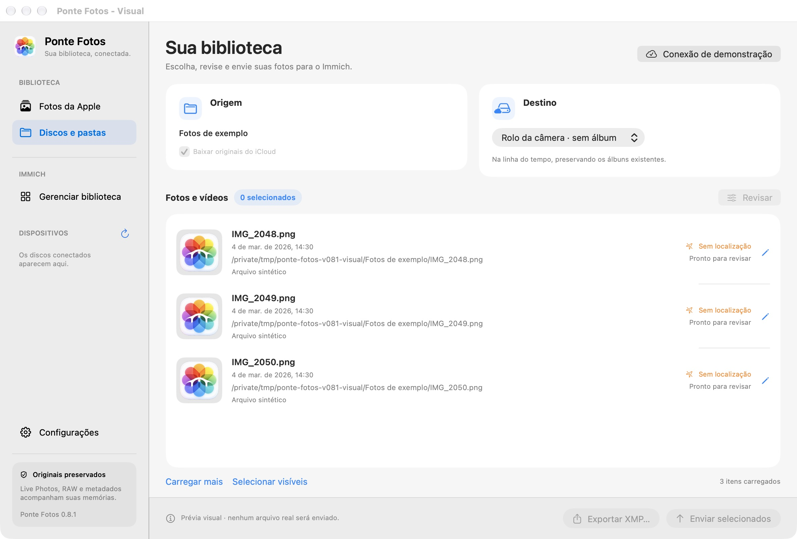
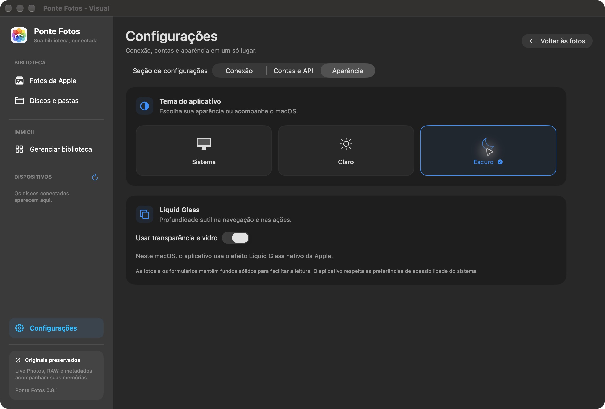
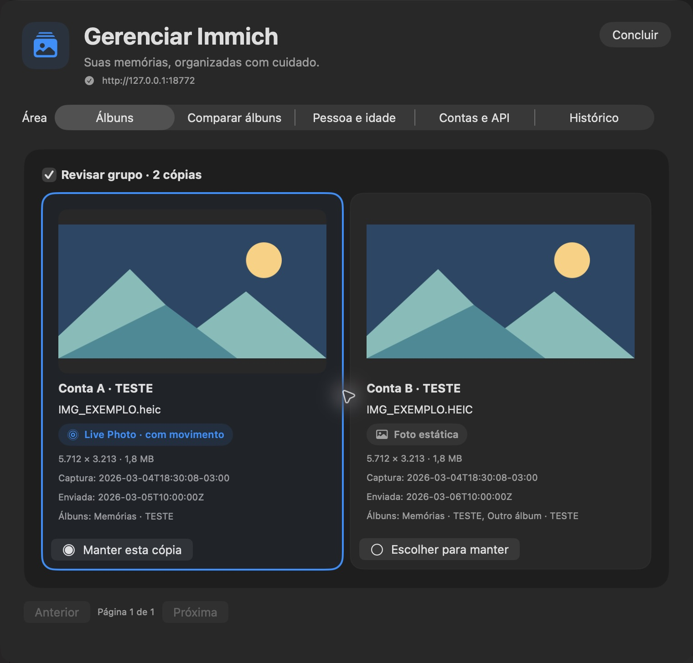
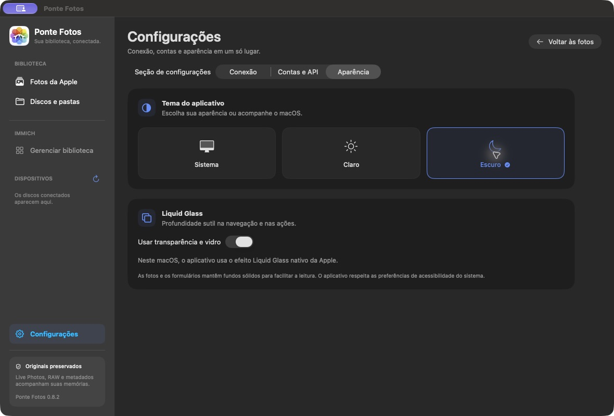
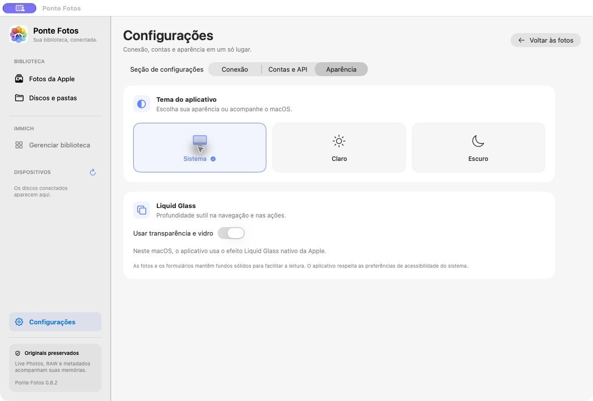
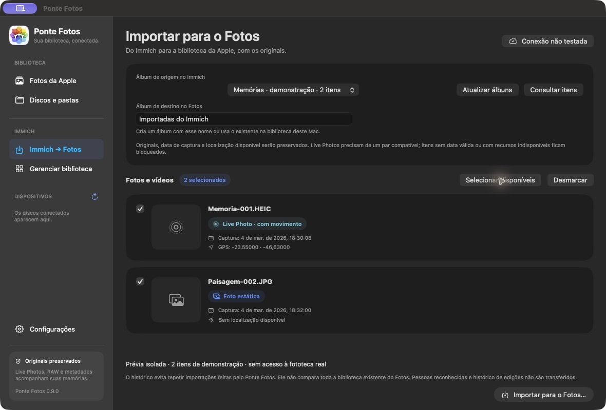
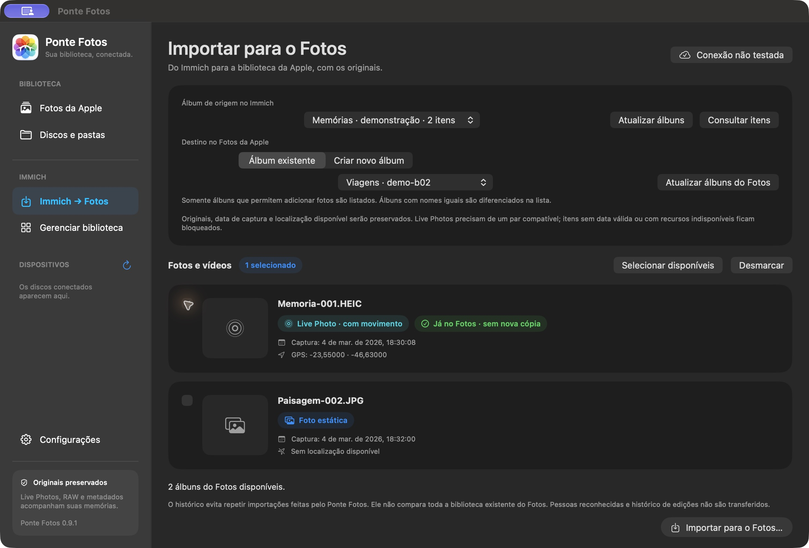
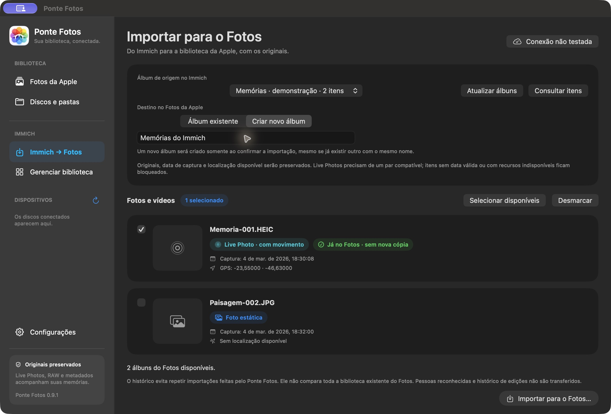

# 🌸 Ponte Fotos — guia completo

**Versão 0.9.2 · Apple Silicon · macOS 14 ou superior · Immich 3.x**

O Ponte Fotos conecta os originais do Fotos da Apple e de pastas ao seu Immich. Você escolhe, revisa data e localização, define o destino e acompanha o envio. Também pode consultar duplicatas entre contas e organizar álbuns do servidor.

[🏠 Repositório](https://github.com/allanpreis/ponte-fotos) · [📦 Releases](https://github.com/allanpreis/ponte-fotos/releases) · [🎬 Vídeo](media/ponte-fotos-promo.mp4) · [📝 Histórico de versões](../CHANGELOG.md)

## 📦 Instalar e atualizar

### Pacote da release

1. Abra a [release mais recente](https://github.com/allanpreis/ponte-fotos/releases/latest) e baixe o ZIP do aplicativo para **arm64 / Apple Silicon**.
2. Confira o SHA-256 do ZIP com o arquivo de checksums anexado à mesma release:

   ```sh
   shasum -a 256 Ponte-Fotos-0.9.2-arm64.zip
   ```

3. Extraia o ZIP e mova **Ponte Fotos.app** para Aplicativos ou para a pasta local `~/Applications`.
4. Encerre a versão antiga antes de substituí-la e abra o aplicativo novo.

A assinatura é **local ad hoc**: o app ainda não tem assinatura Developer ID nem notarização da Apple. O macOS pode pedir autorização para abri-lo; use os controles de **Privacidade e Segurança** do próprio sistema se disponíveis. Não é necessário desativar o Gatekeeper. Prefira instalar fora de pastas sincronizadas que possam alterar atributos do bundle.

Não existe atualizador automático. A atualização é manual pela release; evite remover dados locais ou entradas do Chaves para apenas substituir o app. Uma nova compilação pode levar o macOS a pedir permissões novamente.

### Compilar o código

Instale as ferramentas de linha de comando do Xcode e execute:

```sh
xcode-select --install
git clone https://github.com/allanpreis/ponte-fotos.git
cd ponte-fotos
zsh build.sh
```

O resultado fica em `build/Ponte Fotos.app`. O script atual compila para arm64; Intel não está validado. Node.js, Docker e pacotes Swift externos não são necessários ao app. A reconstrução opcional do vídeo tem ferramentas próprias descritas em [promo/README.md](../promo/README.md).

## 🧭 Conhecer a interface



A barra lateral separa **Biblioteca Apple**, **Discos e pastas**, **Gerenciar Immich** e **Configurações**. A biblioteca concentra origem, destino, seleção e ações; a lista de mídia possui sua própria rolagem. As configurações ficam em uma página dedicada para não ocupar o espaço das fotos.

O app adapta grupos de controles para janelas menores; a janela principal parte de 900 × 650. Formulários longos rolam dentro de sua página e as ações de revisão permanecem acessíveis.

## 🔌 Conexão, APIs e Wi-Fi



Abra **Configurações** pela barra lateral ou por **⌘,**. Em **Conexão**, configure endereços, modo de conexão e chave principal. Estes valores são exemplos fictícios:

| Campo | Exemplo |
| --- | --- |
| URL local | `http://immich.local:2283` |
| URL remota | `https://photos.example.com` |
| Wi-Fi doméstico | `MinhaRede` |
| Chave de API | Preencha a chave criada na sua conta do Immich |

Use a URL base, sem usuário, senha ou parâmetros embutidos. Teste a conexão e use **Salvar configuração** para persistir os dados no **Chaves do macOS**. O código publicado inicia vazio e o app não lê `.env`.

### Modo Automático

Autorize **Localização** pelo aplicativo para o macOS disponibilizar o nome do Wi-Fi. O Ponte Fotos utiliza o SSID para escolher a URL; não consulta nem armazena a posição geográfica do Mac.

- No Wi-Fi doméstico configurado, prioriza a URL local. Falhas elegíveis de conectividade/servidor podem levar à tentativa remota.
- Em outra rede, sem Wi-Fi ou sem acesso ao nome da rede, utiliza a URL remota.
- Erros de autenticação, servidor inválido ou conta divergente não causam troca automática.
- Durante um envio, conserva o cliente do conjunto atual e trata a mudança em um ponto seguro, com revalidação. Não há retomada parcial por byte.
- Os modos **Local** e **Remoto** permitem escolher o endereço manualmente.

Os dois endereços devem apontar para o mesmo servidor confiável. A conferência usa o UUID da conta, não uma identidade criptográfica do servidor. HTTP é aceito, mas não cifra chave e mídia em trânsito; prefira HTTPS para acesso remoto.

### Contas adicionais e permissões

Em **Contas e API**, use a conta da conexão atual ou conecte outras com suas próprias chaves. A conta atual pode ser usada apenas em memória; contas adicionais salvas têm armazenamento separado no Chaves. Uma chave não concede acesso além do permitido àquela conta no Immich.

| Fluxo | Escopos relevantes |
| --- | --- |
| Conectar/enviar | `server.version`, `user.read`, `asset.upload`, `asset.read` |
| Consultar gestão/miniaturas | `user.read`, `album.read`, `asset.read`, `asset.view` |
| Pessoas | `person.read`, além dos escopos de consulta |
| Criar álbum | `album.create` e escopos correspondentes ao destino |
| Organizar vínculos | `albumAsset.create`, `albumAsset.delete` |
| Enviar duplicata à lixeira | `asset.delete`, além da leitura e preservação de álbuns |
| Aplicar revisão a item enviado | `asset.update`, quando necessário |

A versão do servidor e o endpoint podem exigir escopos adicionais. Permissões ausentes bloqueiam a ação; confira a mensagem antes de ampliar a chave. Evite conceder `all` sem necessidade.

## 🎨 Tema e vidro

Em **Aparência**, selecione **Claro**, **Escuro** ou **Sistema**. A preferência é salva e aplicada às janelas de revisão e gestão.

**Usar transparência e vidro** ativa o acabamento da navegação. No macOS 26 ou superior, o app usa Liquid Glass nativo; no macOS 14/15, materiais translúcidos compatíveis. Desligar a opção ou ativar **Reduzir transparência** no sistema produz superfícies opacas. Fotos e formulários mantêm superfícies sólidas para leitura. Tema e vidro ficam no UserDefaults, separados das credenciais.

## 🖼️ Escolher a origem

### Fotos da Apple e iCloud

Abra a biblioteca e autorize acesso ao Fotos. Os itens são carregados em páginas de 100. Quando necessário, habilite baixar originais do iCloud; isso depende da conta, internet, espaço e biblioteca do próprio macOS.

A exportação utiliza recursos originais do PhotoKit. Não promete reproduzir edições, álbuns Apple, legendas, palavras-chave, rostos ou todos os metadados proprietários da Apple.

### Pastas e discos

Escolha uma pasta para leitura recursiva, incluindo subpastas. O app lê imagens, vídeos e XMP associados. Arquivos de origem não são modificados durante preparação e revisão.

HEIC e MOV de pastas são tratados como itens independentes: nome igual não basta para inferir um par Live Photo. Recursos RAW e JPEG associados são preservados separadamente, sem empilhamento automático.

## 🗓️ Revisar e exportar com XMP

Selecione um item e use **Revisar** para completar ou corrigir data e GPS. Sem data confiável, o envio exige revisão; a criação do arquivo não é adotada automaticamente como captura.

A preparação preserva os bytes dos originais e escreve um **XMP complementar** com data e localização da biblioteca ou da revisão. Um XMP existente de pasta é mesclado preservando campos adicionais. Use **Exportar com XMP…** para guardar os arquivos em uma pasta escolhida, sem depender de um Immich acessível.

O PhotoKit fornece um instante absoluto; a prévia usa o fuso do Mac e o XMP complementar usa UTC. Confira especialmente fotos de viagens e correções manuais.

## ⬆️ Enviar e acompanhar

1. Escolha fotos e vídeos e revise os avisos de metadados.
2. Defina o destino: linha do tempo sem álbum, álbum existente ou novo álbum.
3. Envie uma pequena amostra e confira no Immich antes de lotes grandes.
4. Acompanhe resultados por item. **Pausar após este item** conclui o conjunto atual antes de parar.

O fluxo confere checksum, instante de captura com tolerância inferior a um segundo, GPS disponível com tolerância de 0,00001 grau e vínculo do vídeo Live. Favorito é enviado, mas não integra essa conferência. Respostas tardias ou divergentes permanecem pendentes/divergentes em vez de virar sucesso indevido.

Para Live Photos do Fotos da Apple, o vídeo é enviado primeiro e associado à imagem principal. Histórico e checksum permitem reutilizar recursos já enviados e ainda válidos. Depois de interrupções, confira resultados pendentes/incertos no servidor antes de repetir.

## 🧹 Duplicatas entre contas e álbuns



Com a conexão validada, abra **Gerenciar Immich → Álbuns**, selecione os álbuns e consulte duplicatas. Álbuns compartilhados aparecem uma vez.

O método compara **checksum exato e tipo de mídia**, inclusive a imagem principal de Live Photos. Não é reconhecimento visual: mesma aparência ou mesmo nome isoladamente não comprovam duplicação; edições, recompressão e bytes diferentes podem impedir a correspondência.

Cada cópia mostra conta, arquivo, metadados e álbuns acessíveis. Os indicadores **Live Photo · com movimento** e **Foto estática** ocupam espaço próprio, sem sobrepor nomes e datas. Uma Live Photo é sugerida para manter; o descarte de qualquer Live Photo é bloqueado.

Antes de alterar, o app revalida conteúdo, proprietário, movimento, acesso e vínculos. Preserva os álbuns acessíveis na cópia mantida e confirma as adições antes da primeira exclusão. A cópia excedente vai à lixeira recuperável do Immich, com `force: false`; o app não esvazia a lixeira. Sem a conta proprietária conectada, grupos podem ser bloqueados. Álbuns invisíveis às contas conectadas não podem ser preservados pelo app.

## 🗂️ Comparar álbuns

Escolha dois álbuns. A consulta mostra conteúdos comuns e pode incluir exclusivos. Para cada grupo, escolha deixar como está, manter nos dois ou reunir em um dos álbuns.

Adições são confirmadas antes da remoção dos vínculos de origem. **Os arquivos continuam na biblioteca**: este fluxo organiza associações a álbuns.

## 🎂 Pessoa e idade

Escolha conta, pessoa, origem, destino e intervalo inclusivo de idade. A pessoa precisa ter aniversário registrado no Immich. A seleção considera a data local de captura; para nascimento em 29 de fevereiro, o aniversário é tratado como 1º de março em anos não bissextos.

A origem pode ser um álbum ou os álbuns acessíveis da conta, exceto o destino. Antes de organizar, o app revalida aniversário, pessoa, captura e conteúdo. Vínculos de outros álbuns fora da origem escolhida são preservados.

## 🧾 Revisão, confirmações e histórico

Alterações da gestão exigem revisão e confirmação explícita. O histórico registra até **20 execuções**, com o estado de cada ação antes e depois da solicitação.

Uma falha pode deixar parte concluída e parte incerta. Não há rollback geral nem repetição automática: confira o histórico e o servidor antes de agir novamente. Análises prontas e escolhas não são restauradas ao fechar a gestão; credenciais da sessão permanecem disponíveis conforme o perfil ativo.

## 🔐 Dados locais e privacidade

| Armazenamento | Conteúdo |
| --- | --- |
| Chaves do macOS | Perfil, URLs, SSID e chave principal; contas adicionais em serviço separado |
| `~/Library/Application Support/PonteFotos/reviews.json` | Revisões de metadados |
| `~/Library/Application Support/PonteFotos/history/` | Histórico de envio, IDs e checksums |
| `~/Library/Application Support/PonteFotos/management/` | Histórico de gestão por perfil; arquivos com modo `0600` |
| `~/Library/Application Support/PonteFotos/staging/` | Cópias temporárias de preparação |
| Pasta de exportação escolhida | Originais e XMP exportados |

Revisões, históricos e exportações podem conter nomes, IDs, datas e GPS pessoais. Não os publique. **Esquecer conexão salva** remove a conexão principal do Chaves, mas campos atuais continuam na memória até fechar; contas adicionais e históricos não são removidos automaticamente. Interrupções abruptas podem deixar arquivos temporários.

O repositório não precisa de `.env`; o `.gitignore` exclui credenciais usuais, dados de execução, builds e bundles. Isso não remove um segredo já versionado nem substitui a inspeção de cada publicação. Screenshots e animações de documentação usam dados ilustrativos.

## 🧪 Desenvolvimento e validação

```sh
zsh build.sh
zsh test-connection.sh
zsh test-management.sh
zsh test-media.sh
zsh test-appearance.sh
plutil -lint Info.plist
codesign --verify --deep --strict "build/Ponte Fotos.app"
```

Testes usam dados sintéticos e interceptação HTTP em memória. A suíte de mídia cria JPEG/MOV temporários e requer codecs disponíveis no macOS; uma sandbox restrita pode impedir a codificação. A fixture HTTP opcional usa Python 3 e escuta apenas em `127.0.0.1:18761`.

Validação automatizada não substitui testes reais de PhotoKit, permissões, troca física de Wi-Fi e compatibilidade com o servidor. O servidor local já voltou a responder. Nesta atualização, os testes de gravação usam dependências sintéticas; não foram criados álbuns ou alteradas fotos reais durante a validação do novo seletor.

## ⚠️ Limites conhecidos

- Até 100 álbuns e 30 mil itens únicos por análise.
- Comparação e pessoa/idade excluem Live Photos, pilhas, arquivos offline e editados; duplicatas incluem a imagem Live com proteção contra descarte.
- A conta proprietária pode ser exigida conservadoramente mesmo para organização.
- Consultas podem ser canceladas; alterações não são canceladas no meio de uma chamada de rede.
- Não há detecção perceptual, sincronização contínua de toda a biblioteca nem atualizador automático.
- Criação de destinos extras no fluxo de duplicatas e decisões em lote da comparação não estão disponíveis.
- Operações grandes podem demorar por causa das revalidações de segurança.
- Integração desenvolvida com Immich 3.3.5; atualizações da API podem exigir ajustes.

## 🛠️ Problemas comuns

| Sintoma | Conferir |
| --- | --- |
| Sem comunicação | Servidor ativo, URL, porta, DNS, rota e firewall |
| Rede não identificada | Localização autorizada, Wi-Fi ativo, SSID exato; tente modo manual |
| Biblioteca vazia | Privacidade e Segurança → Fotos e biblioteca selecionada no Fotos |
| Original iCloud indisponível | Conta, internet, espaço livre e opção de baixar originais |
| Gestão bloqueada | Conta proprietária, escopos, acesso ao álbum e tipos de mídia excluídos |
| Cópias parecidas ausentes | A análise exige bytes/checksum idênticos |
| Resultado incerto | Conferir histórico e servidor antes de repetir |
| Assinatura inválida | Recompilar e instalar fora de sincronizadores; verificar `codesign` |

O projeto é independente, sem vínculo oficial com Apple ou Immich. Uma licença de redistribuição ainda não foi definida. Consulte [como publicamos versões](RELEASING.md) para o processo de commits, documentação e releases.


## 🛠️ Correções visuais da 0.8.2

O ícone usa a área inteira do enquadramento fornecido pelo macOS, sem a imagem reduzida dentro de uma segunda base. A logo da barra lateral usa o bitmap em alta resolução, com tamanho lógico correto para telas Retina.

Ao selecionar **Configurações → Aparência → Sistema**, a janela passa imediatamente a seguir o macOS. Não é necessário reiniciar. Janelas e painéis herdam a aparência do aplicativo.




Prints de prévia isolada, sem chaves, fotos ou endereços reais. Testes AppKit também cobrem retorno de Claro para Sistema; a troca global do macOS não foi alterada durante o teste visual.


## 📥 Importar do Immich para o Fotos da Apple



1. Teste a conexão em **Configurações** e abra **Immich → Fotos**, na seção Immich da barra lateral.
2. Clique em **Atualizar álbuns**, selecione o álbum de origem e consulte os itens. Abrir a página não inicia downloads de originais nem importações.
3. Selecione os itens disponíveis e confira miniaturas, data, GPS e os indicadores Live Photo/foto estática/vídeo. A data mostrada usa o fuso de exibição do Mac; o instante original precisa ter fuso explícito.
4. Em **Destino no Fotos da Apple**, escolha **Álbum existente** ou **Criar novo álbum**. Para um existente, clique em **Atualizar álbuns do Fotos** e escolha na lista; para um novo, informe o nome.
5. Clique em **Importar para o Fotos…**, revise a confirmação e autorize o Fotos se o macOS solicitar. É necessário acesso completo para gravar e conferir itens já importados.
6. Acompanhe o progresso. Cancelar interrompe entre itens; itens já confirmados permanecem no Fotos e no histórico. Uma gravação PhotoKit iniciada precisa terminar.

O app usa a biblioteca disponibilizada pelo PhotoKit no Mac, normalmente a Fototeca do Sistema. Não escolhe automaticamente outra fototeca. O envio ao iCloud depende das configurações do Fotos e do espaço disponível.

### Dados preservados e limites

- Arquivo original, sem recodificação, com seus metadados técnicos existentes.
- Data/hora e coordenadas atuais informadas pelo Immich são aplicadas ao novo item do Fotos, incluindo ajustes que não estejam embutidos no original.
- Live Photo: imagem e vídeo originais são baixados e verificados; pares incompatíveis são bloqueados, sem conversão silenciosa em foto estática.
- Não há transferência garantida de pessoas reconhecidas, histórico de edições, tags, avaliações ou legendas específicas de cada produto. Não há garantia de reconstruir pares RAW+JPEG como um só item.
- Esta primeira versão seleciona origem por álbum, usando a conta principal configurada. Não é uma sincronização automática/bidirecional contínua.
- Data ausente/sem fuso explícito, GPS incompleto/inválido, original na lixeira/offline ou checksum inválido impedem a importação. Corrija os dados no Immich e consulte novamente.

### Histórico e repetições

O histórico de importação fica em `~/Library/Application Support/PonteFotos/reverse-import/`, separado do histórico de envio. Ele usa uma identidade derivada do perfil e da conta, mantendo continuidade entre conexão local e remota. Arquivos têm permissão restrita e não armazenam a chave da API.

O app verifica o identificador do item no Fotos antes de pular uma importação já concluída. Isso protege somente itens importados por este app; fotos que já estavam na biblioteca por outros caminhos podem ser duplicadas. Resultados incertos ficam bloqueados para evitar novas cópias; confira a biblioteca e preserve o histórico para diagnóstico. Não apague o histórico para repetir lotes sem revisar o resultado.

A operação não apaga nem modifica arquivos no Immich. A importação consome espaço no Mac e, se habilitado, no iCloud. Testes desta versão usam arquivos e serviços simulados; a compatibilidade completa com o servidor real e a fototeca real exige validação posterior em um lote pequeno autorizado.


### 🗂️ Escolher um álbum existente ou criar um novo — 0.9.1



**Álbum existente:** clique em **Atualizar álbuns do Fotos**. A primeira consulta pode pedir acesso ao Fotos. Só são listados álbuns comuns que permitem adicionar conteúdo; álbuns inteligentes e destinos não editáveis ficam de fora. Consultar a lista não cria nem altera fotos ou álbuns. Nomes repetidos recebem um complemento para diferenciá-los; a operação usa o identificador exato do álbum, nunca uma busca pelo nome. Se o destino for removido ou perder permissão, a operação é bloqueada e você deve atualizar a lista.

**Criar novo álbum:** informe o nome e confirme a importação. Será criado um álbum novo, mesmo que outro já tenha o mesmo nome. Dentro do lote, o álbum é criado uma vez e todos os itens vão para ele. Após a primeira operação confirmada, o app seleciona o álbum criado como existente para os próximos lotes.



**Fotos já importadas:** itens marcados como já presentes no Fotos podem ser selecionados novamente. O app usa o identificador salvo no histórico para adicioná-los ao destino, sem novo download nem nova cópia e sem removê-los dos álbuns anteriores. Essa ação não reaplica alterações de metadados feitas posteriormente no Immich. Ela depende do histórico deste app e não reconhece automaticamente fotos importadas por outros programas.

Confira o destino na confirmação. Cancelar a confirmação não cria álbuns nem adiciona itens. Se houver interrupção com resultado incerto, confira o Fotos antes de repetir, especialmente ao criar um novo álbum. Não há garantia de retomada automática de criação de álbum após encerramento abrupto.


### 📶 Estabilidade da seleção — 0.9.2

Avisos repetidos de rede do macOS, sem mudança de rota ou Wi-Fi, não reiniciam a conexão automática. Ao atualizar explicitamente os álbuns do Immich na mesma conexão, o álbum escolhido permanece selecionado pelo ID. Se ele tiver sido removido, escolha outro; o app não substitui uma seleção removida silenciosamente. Mudanças reais de conexão continuam invalidando consultas por segurança.
